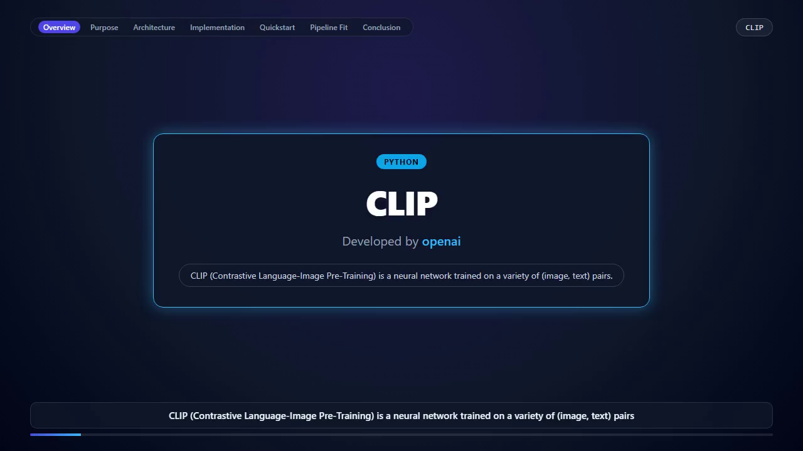
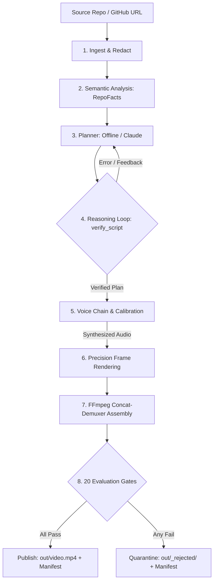

# DevVideo: Grounded Developer Explainer Video Generator

DevVideo autonomously generates 50–58 second, 720p 30fps narrated developer explainer videos from any GitHub repository or local codebase. Built for AI video understanding and retrieval pipelines, diagram, code and terminal frames are built from parsed repo data; narration is extractive from README/docstrings, verbatim syntax-highlighted code, and verified shell commands with audible voice narration. Alongside the video, DevVideo generates synchronized WebVTT/SRT transcripts, chapter markers, and search-ready index records.

---

## Sample Explainer Video & Outputs

[](docs/sample/video.mp4)

*Sample explainer generated autonomously from the [openai/CLIP](https://github.com/openai/CLIP) repository.*

<!-- BEGIN:GENERATED:sample_stats -->
- **Video**: [docs/sample/video.mp4](docs/sample/video.mp4) (49.6s, H.264/AAC, 1.14 MB)
- **Subtitles**: [docs/sample/transcript.vtt](docs/sample/transcript.vtt) & [docs/sample/transcript.srt](docs/sample/transcript.srt)
- **Chapters**: [docs/sample/chapters.json](docs/sample/chapters.json)
- **Retrieval Index**: [docs/sample/index.jsonl](docs/sample/index.jsonl)
- **Eval Report**: [docs/sample/eval_report.json](docs/sample/eval_report.json) (All 20 evaluation gates passed)
- **Manifest**: [docs/sample/manifest.json](docs/sample/manifest.json)
<!-- END:GENERATED:sample_stats -->

Try querying the generated sample video with the pure-Python TF-IDF retrieval tool:
<!-- BEGIN:GENERATED:search_demo -->
```bash
python tools/search_demo.py docs/sample "where is the CLI explained"
# Output:
# Top video timestamps for 'where is the CLI explained':
#   [0.094] 007.8s - 013.8s | OVERVIEW   | It can be instructed in natural language to predict the most relevant text snippet, given an image.
#   [0.093] 040.5s - 046.9s | RECAP      | In summary, it can be instructed in natural language to predict the most relevant text snippet.
#   [0.074] 000.2s - 007.5s | TITLE      | CLIP (Contrastive Language-Image Pre-Training) is a neural network trained on a variety of (image, text) pairs.
```
<!-- END:GENERATED:search_demo -->

---

## Quickstart (Zero API Keys Required)

Run end-to-end locally with default production backends (zero API keys required):

```bash
# 1. Clone repository and install dependencies
git clone https://github.com/P1Manav/DevVideo.git
cd DevVideo
pip install -r requirements.txt -r requirements-dev.txt
playwright install chromium

# 2. Run the test suite <!-- BEGIN:GENERATED:test_count -->(339 passed, 1 skipped)<!-- END:GENERATED:test_count -->
pytest tests/ -v

# 3. Generate an explainer video
python src/main.py generate tests/fixtures/vidsearch_py --out out/
```

### Web Frontend & UI

DevVideo includes a lightweight, modern web frontend allowing users to generate and watch videos directly in their browser:

```bash
# Start web server locally on port 10000
python -m src.cli serve --port 10000
# Or directly via module
python -m src.web
```

Visit `http://localhost:10000` to:
- Enter any GitHub repository URL (e.g. `https://github.com/psf/requests`).
- Track live generation progress.
- Watch the output video in the embedded HTML5 player with synchronized subtitles and chapter navigation.
- Download MP4 video, WebVTT subtitles, and evaluation manifests.

---

## Deploying to Render (24/7 Keep-Alive)

DevVideo is fully configured for zero-configuration deployment to [Render](https://render.com) using Docker:

### 1-Click / Blueprint Deployment
1. Connect your repository to Render.
2. Select **Blueprint** and Render will automatically detect `render.yaml`.
3. Or create a **Web Service** with **Docker** runtime:
   - **Environment**: `Docker`
   - **Health Check Path**: `/healthz`
   - **Plan**: Free or Starter
   - **Port**: `10000`

### Automatic Keep-Alive (Prevent Free-Tier Sleep)
Render's free tier automatically spins down web services after 15 minutes of inactivity. DevVideo includes a built-in background keep-alive worker that runs **once every 60 seconds**:
- It automatically detects Render's public URL via `RENDER_EXTERNAL_URL` (e.g., `https://your-service.onrender.com`).
- It sends an HTTP GET request to `https://your-service.onrender.com/healthz` once per minute.
- Because the ping originates through Render's public routing ingress, Render registers active incoming web traffic and **keeps the deployment awake 24/7**.
- You can check monitor status at `/healthz` or `/api/keepalive`.


---

## How It Works

DevVideo processes repositories through a 7-stage linear pipeline reinforced by bounded verify-revise loops:



1. **Ingest & Security**: Strict URL validation, git clone isolation (`core.symlinks=false`, empty hooks), and multi-pattern secret redaction.
2. **Semantic Analysis**: Python AST and JS regex dependency graphs, verbatim code slices, and word-boundary domain relevance scoring.
3. **Planning**: `OfflinePlanner` (fact-conditional 7 scenes) or `ClaudePlanner` (`claude -p` stdin inside nonce-delimited untrusted block).
4. **Reasoning Loop**: Pre-synthesis verification of evidence quotes, lexical overlap, line ranges, and duration budget (max 2 retries).
5. **Adaptive Voice**: Runtime probe chain (`edge` -> `espeak-ng` -> `pyttsx3` -> `silent`) with atomic restart on error (zero mixed voices).
6. **Precision Rendering**: Headless Playwright Chromium (JS disabled) with Pygments syntax highlighting, SVG graph, and Pillow fallback.
7. **Assembly & Muxing**: FFmpeg concat-demuxer with repeated final entries to eliminate A/V drift.
8. **Evaluation Gates**: <!-- BEGIN:GENERATED:gate_count -->20<!-- END:GENERATED:gate_count --> evaluation gates evaluate the final MP4. Videos failing any gate are quarantined to `out/_rejected/`.

---

## Output Deliverables

| File | Format | Purpose |
|------|--------|---------|
| `video.mp4` | MP4 (H.264 / AAC, 720p, 30fps) | Final synchronized explainer video (<60s, <8 MB). |
| `thumbnail.png` | PNG (1280x720) | High-contrast video preview frame. |
| `transcript.vtt` | WebVTT | Web-standard subtitles synchronized to spoken narration beats. |
| `transcript.srt` | SubRip SRT | Standard subtitle format for media players. |
| `chapters.json` | JSON | Timed chapter markers matching scene boundaries. |
| `index.jsonl` | JSON Lines | Search-ready records with timestamp ranges, evidence files, and text. |
| `scenes.json` | JSON | Full structured script plan, beats, visual focus, and quotes. |
| `eval_report.json` | JSON | Results of all evaluation gates and soft metrics. |
| `manifest.json` | JSON | Audit trail with relative POSIX paths, git SHAs, timings, and SHA-256 media hash. |

---

## Hard Evaluation Gates

Videos are only published if all <!-- BEGIN:GENERATED:gate_count -->20<!-- END:GENERATED:gate_count --> evaluation gates pass:

<!-- BEGIN:GENERATED:gates_table -->
| Gate | Target / Threshold | Description | Code Location |
|------|-------------------|-------------|---------------|
| `duration` | `<= 60.0s` | Container duration measured via ffprobe on final MP4. | [gates.py](src/evals/gates.py) |
| `av_sync` | `Scene <= 0.15s, Stream <= 0.30s` | Maximum drift between audio and video across scenes and streams. | [gates.py](src/evals/gates.py) |
| `audio_audible` | `> -35.0 dB` | Audio stream presence and loudness measured via ffmpeg volumedetect. | [gates.py](src/evals/gates.py) |
| `groundedness` | `100%` | Every scene and beat cites valid source spans with >= 60% token grounding. | [gates.py](src/evals/gates.py) |
| `code_verbatim` | `100%` | Code scene content is an exact verbatim line range from cited source. | [gates.py](src/evals/gates.py) |
| `rendered_code_matches` | `100%` | All characters and indentation in code excerpt are preserved on-screen. | [gates.py](src/evals/gates.py) |
| `command_validity` | `100%` | Shell commands shown exist verbatim in repo code fences (N/A if 0 commands). | [gates.py](src/evals/gates.py) |
| `secret_leaks` | `0` | Zero credentials detected via independent multi-pattern scanner. | [gates.py](src/evals/gates.py) |
| `no_overflow` | `0` | No dropped lines or bounding box clipping measured in DOM or Pillow. | [gates.py](src/evals/gates.py) |
| `frames_valid` | `100%` | Sampled video frames contain non-flat visual content. | [gates.py](src/evals/gates.py) |
| `narration_quality` | `0 violations` | No banned buzzwords, no dangling endings, verbs present in every beat. | [gates.py](src/evals/gates.py) |
| `specificity` | `100%` | Every beat names >= 1 concrete repo-specific identifier or symbol. | [gates.py](src/evals/gates.py) |
| `onscreen_text_integrity` | `0 violations` | No on-screen text ends mid-word or with dangling stopword; bullets grounded. | [gates.py](src/evals/gates.py) |
| `motion` | `>= 24 changes, max gap <= 5.0s` | Content region motion events sampled at 5 fps with max idle window <= 5s. | [gates.py](src/evals/gates.py) |
| `voice_present` | `Pass` | Verified voice engine present (non-blocking unless DEVVIDEO_REQUIRE_VOICE=1). | [gates.py](src/evals/gates.py) |
| `duration_margin` | `<= 55.0s` | Duration budget margin check (warning at > 55s, blocking at > 60s). | [gates.py](src/evals/gates.py) |
| `code_highlight_focus` | `<= 60% focus ratio, >= 1 focused row` | Highlight focus is constrained to <= 60% and max 5 rows per code beat. | [gates.py](src/evals/gates.py) |
| `code_window_visible` | `100%` | Header with file path is visible and rows remain inside code container. | [gates.py](src/evals/gates.py) |
| `decoration_free` | `0 violations` | No fake synthesis banners, fake percentage progress bars, or decorative widgets. | [gates.py](src/evals/gates.py) |
| `onscreen_matches_voice` | `100%` | Every bullet, takeaway, and caption traces to spoken beats without news items. | [gates.py](src/evals/gates.py) |
<!-- END:GENERATED:gates_table -->

---

## CLI Options & Hooks

```bash
python -m src.cli generate <github-url|local-dir> [OPTIONS]

Options:
  --out PATH            Output directory (default: out/)
  --llm [auto|offline|claude]  LLM planner selection (default: auto)
  --tts [auto|edge|espeak|pyttsx3|silent]  TTS backend selection (default: auto)
  --voice TEXT          TTS voice name override
  --renderer [auto|playwright|pillow]  Rendering engine (default: auto)
  --budget-seconds INT  Speech duration target in seconds (default: 55)
  --webhook URL         Outbound webhook URL (HTTPS only, SSRF protected)
  --keep-frames         Keep temporary intermediate frame PNGs
```

### Exit Codes
- `0`: Video published successfully and passed all evaluation gates.
- `1`: Gate failure; video was rejected and quarantined to `out/_rejected/`.
- `2`: Fatal pipeline error or unrecoverable exception.

---

## Honest Limitations

1. **Claude CLI Integration**: The Claude planner path is designed strictly as a subprocess calling `claude -p` with prompts piped via standard input. This path is verified via comprehensive mocked-subprocess test suites; live invocation requires the local Claude CLI binary and credentials.
2. **Online vs Local TTS**: Edge TTS provides natural neural voices but requires an active internet connection. Offline environments automatically fall back to local `espeak-ng` or SAPI5 `pyttsx3`.
3. **Groundedness Scope**: The groundedness evaluation gate strictly verifies exact quote presence (>= 20 characters) and lexical content token overlap (>= 2 identifiers/nouns). It verifies factual containment, not semantic logical entailment.
4. **Offline Planning**: The default `OfflinePlanner` uses deterministic fact-conditional templates derived from AST and README facts, guaranteeing 100% predictable, reproducible execution without external API dependencies.
5. **Docker Execution**: The Docker container has been designed with UID 10001 `devvideo` non-root user permissions and verified via the project test suite. Full multi-platform matrix verification logs are detailed in [STATUS.md](docs/verification/STATUS.md).

For detailed verification command logs and audit trails, see [docs/verification/STATUS.md](docs/verification/STATUS.md).
