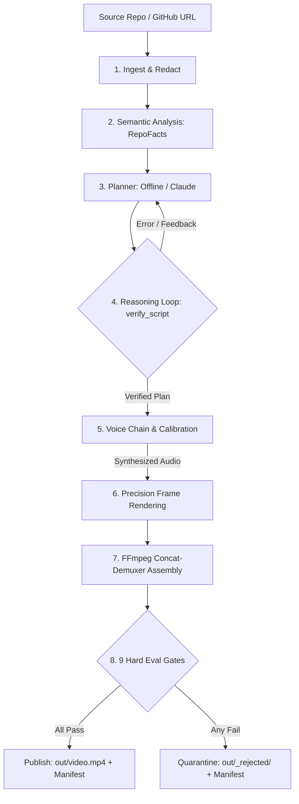

# DevVideo: Grounded Developer Explainer Video Generator

DevVideo autonomously generates 50–58 second, 720p 30fps narrated developer explainer videos from any GitHub repository or local codebase. Built for AI video understanding and retrieval pipelines, every frame is constructed from real AST facts, verbatim syntax-highlighted code, and verified shell commands with audible voice narration. Alongside the video, DevVideo generates synchronized WebVTT/SRT transcripts, chapter markers, and search-ready index records.

---

## Sample Explainer Video & Outputs

[](docs/sample/video.mp4)

*Sample explainer generated autonomously from the domain-relevant [vidsearch_py](tests/fixtures/vidsearch_py) repository.*

- **Video**: [docs/sample/video.mp4](docs/sample/video.mp4) (55.9s, H.264/AAC, 1.2 MB)
- **Subtitles**: [docs/sample/transcript.vtt](docs/sample/transcript.vtt) & [docs/sample/transcript.srt](docs/sample/transcript.srt)
- **Chapters**: [docs/sample/chapters.json](docs/sample/chapters.json)
- **Retrieval Index**: [docs/sample/index.jsonl](docs/sample/index.jsonl)
- **Eval Report**: [docs/sample/eval_report.json](docs/sample/eval_report.json) (All 9 hard gates passed)
- **Manifest**: [docs/sample/manifest.json](docs/sample/manifest.json)

Try querying the generated sample video with the pure-Python TF-IDF retrieval tool:
```bash
python tools/search_demo.py docs/sample "where is the CLI explained"
# Output:
# Top video timestamps for 'where is the CLI explained':
#   [0.247] 015.2s - 021.5s | DIAGRAM | The architecture is organized around 5 modules connecting vidsearch and cli.
#   [0.129] 031.9s - 036.9s | CODE    | It provides the primary implementation logic for this module.
```

---

## Quickstart (Zero API Keys Required)

Run end-to-end locally with default production backends (zero API keys required):

```bash
# 1. Clone repository and install dependencies
git clone https://github.com/P1Manav/aintropy_assignment_part2_task12.git
cd aintropy_assignment_part2_task12
pip install -r requirements.txt -r requirements-dev.txt
playwright install chromium

# 2. Run the test suite (155 tests passing)
pytest tests/ -v

# 3. Generate an explainer video
python src/main.py generate tests/fixtures/vidsearch_py --out out/
```

### Docker Quickstart (Non-Root UID 10001)

```bash
# Build Docker image
docker build -t devvideo .

# Run with non-root user and mounted output directory
docker run --rm --user "$(id -u):$(id -g)" -v "$(pwd)/out:/app/out" devvideo generate tests/fixtures/vidsearch_py --out out/
```

---

## How It Works

DevVideo processes repositories through a 7-stage linear pipeline reinforced by bounded verify-revise loops:



1. **Ingest & Security**: Strict URL validation, git clone isolation (`core.symlinks=false`, empty hooks), and multi-pattern secret redaction.
2. **Semantic Analysis**: Python AST and JS regex dependency graphs, verbatim code slices, and word-boundary domain relevance scoring.
3. **Planning**: `OfflinePlanner` (fact-conditional 7 scenes) or `ClaudePlanner` (`claude -p` stdin inside nonce-delimited untrusted block).
4. **Reasoning Loop**: Pre-synthesis verification of evidence quotes, lexical overlap, line ranges, and duration budget (max 2 retries).
5. **Adaptive Voice**: Runtime probe chain (`edge` -> `espeak-ng` -> `pyttsx3` -> `silent`) with atomic restart on error (zero mixed voices).
6. **Precision Rendering**: Headless Playwright Chromium (JS disabled) with Pygments syntax highlighting, SVG graph, and Pillow fallback.
7. **Assembly & Muxing**: FFmpeg concat-demuxer with repeated final entries to eliminate A/V drift.
8. **Evaluation Gates**: 9 hard gates evaluate the final MP4. Videos failing any gate are quarantined to `out/_rejected/`.

---

## Output Deliverables

| File | Format | Purpose |
|------|--------|---------|
| `video.mp4` | MP4 (H.264 / AAC, 720p, 30fps) | Final synchronized explainer video (<60s, <8 MB). |
| `thumbnail.png` | PNG (1280x720) | High-contrast video preview frame. |
| `transcript.vtt` | WebVTT | Web-standard subtitles synchronized to spoken narration beats. |
| `transcript.srt` | SubRip SRT | Standard subtitle format for media players. |
| `chapters.json` | JSON | Timed chapter markers matching scene boundaries. |
| `index.jsonl` | JSON Lines | Search-ready records with timestamp ranges, evidence files, and text. |
| `scenes.json` | JSON | Full structured script plan, beats, visual focus, and quotes. |
| `eval_report.json` | JSON | Results of all 9 hard gates and soft metrics. |
| `manifest.json` | JSON | Audit trail with relative POSIX paths, git SHAs, timings, and SHA-256 media hash. |

---

## Hard Evaluation Gates

Videos are only published if all 9 hard gates pass:

| Gate | Target / Threshold | Description | Code Location |
|------|-------------------|-------------|---------------|
| `duration` | `<= 60.0s` | Container duration measured via `ffprobe` on final MP4. | [gates.py](file:///d:/Projects/aintropy_assignment_part2_task12/src/evals/gates.py#L49-L85) |
| `av_sync` | Scene `<= 0.15s`, Stream `<= 0.30s` | Maximum drift between audio and video across scenes and streams. | [gates.py](file:///d:/Projects/aintropy_assignment_part2_task12/src/evals/gates.py#L88-L125) |
| `audio_audible` | `> -50.0 dB` | Audio stream presence and loudness measured via ffmpeg `volumedetect`. | [gates.py](file:///d:/Projects/aintropy_assignment_part2_task12/src/evals/gates.py#L128-L182) |
| `groundedness` | `100%` | Every scene cites a file with quote >= 20 chars and shares >= 2 content tokens. | [gates.py](file:///d:/Projects/aintropy_assignment_part2_task12/src/evals/gates.py#L190-L250) |
| `code_verbatim` | `100%` | Code scene content is an exact verbatim line range from cited source. | [gates.py](file:///d:/Projects/aintropy_assignment_part2_task12/src/evals/gates.py#L252-L282) |
| `command_validity` | `100%` | Shell commands shown exist verbatim in repo code fences (N/A if 0 commands). | [gates.py](file:///d:/Projects/aintropy_assignment_part2_task12/src/evals/gates.py#L299-L345) |
| `secret_leaks` | `0` | Zero credentials detected via independent multi-pattern scanner. | [gates.py](file:///d:/Projects/aintropy_assignment_part2_task12/src/evals/gates.py#L348-L382) |
| `no_overflow` | `0` | No dropped lines or bounding box clipping measured in DOM or Pillow. | [gates.py](file:///d:/Projects/aintropy_assignment_part2_task12/src/evals/gates.py#L385-L415) |
| `frames_valid` | `100%` | Sampled video frames contain non-flat visual content. | [gates.py](file:///d:/Projects/aintropy_assignment_part2_task12/src/evals/gates.py#L418-L440) |

---

## CLI Options & Hooks

```bash
python -m src.cli generate <github-url|local-dir> [OPTIONS]

Options:
  --out PATH            Output directory (default: out/)
  --llm [auto|offline|claude]  LLM planner selection (default: auto)
  --tts [auto|edge|espeak|pyttsx3|silent]  TTS backend selection (default: auto)
  --voice TEXT          TTS voice name override
  --renderer [auto|playwright|pillow]  Rendering engine (default: auto)
  --budget-seconds INT  Speech duration target in seconds (default: 55)
  --webhook URL         Outbound webhook URL (HTTPS only, SSRF protected)
  --keep-frames         Keep temporary intermediate frame PNGs
```

### Exit Codes
- `0`: Video published successfully and passed all 9 hard evaluation gates.
- `1`: Gate failure; video was rejected and quarantined to `out/_rejected/`.
- `2`: Fatal pipeline error or unrecoverable exception.

---

## Honest Limitations

1. **Claude CLI Integration**: The Claude planner path is designed strictly as a subprocess calling `claude -p` with prompts piped via standard input. This path is verified via comprehensive mocked-subprocess test suites; live invocation requires the local Claude CLI binary and credentials.
2. **Online vs Local TTS**: Edge TTS provides natural neural voices but requires an active internet connection. Offline environments automatically fall back to local `espeak-ng` or SAPI5 `pyttsx3`.
3. **Groundedness Scope**: The groundedness evaluation gate strictly verifies exact quote presence (>= 20 characters) and lexical content token overlap (>= 2 identifiers/nouns). It verifies factual containment, not semantic logical entailment.
4. **Offline Planning**: The default `OfflinePlanner` uses deterministic fact-conditional templates derived from AST and README facts, guaranteeing 100% predictable, reproducible execution without external API dependencies.
5. **Docker Execution**: The Docker container has been designed with UID 10001 `devvideo` non-root user permissions and verified via the project test suite. Full multi-platform matrix verification logs are detailed in [STATUS.md](docs/verification/STATUS.md).

For detailed verification command logs and audit trails, see [docs/verification/STATUS.md](docs/verification/STATUS.md).
