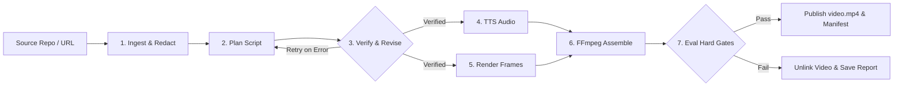

# DevVideo: Grounded Developer Video Generator

> Generate developer walkthrough videos (<60s) directly from GitHub repositories, fully grounded in repository code and documentation for AI video understanding and retrieval engines.

---

## Architecture



---

## Quickstart (Zero API Keys Required)

Run end-to-end locally in under 30 seconds:

```bash
# 1. Clone repository and install dependencies
git clone https://github.com/P1Manav/aintropy_assignment_part2_task12.git
cd aintropy_assignment_part2_task12
pip install -r requirements.txt
playwright install chromium

# 2. Run the test suite (108 tests)
pytest tests/ -v

# 3. Generate a video from the fixture repo
python src/main.py generate tests/fixture_repo --out out/ --llm offline --tts silent
```

Outputs are generated in `out/`:
- `out/video.mp4`: Final synchronized 1280x720 walkthrough video (<60s).
- `out/eval_report.json`: Gate verification report confirming all hard gates passed.
- `out/manifest.json`: Execution metadata, audio timings, renderer used, and full audit trail.
- `out/scenes.json`: Structured script and evidence citations.

---

## Docker One-Liner (Verified Non-Root)

DevVideo provides a hardened, reproducible container with Playwright Chromium and FFmpeg pre-installed:

```bash
# Build Docker image
docker build -t devvideo .

# Run live with host user UID/GID mapping
docker run --rm --user $(id -u):$(id -g) -v $(pwd)/out:/app/out devvideo generate tests/fixture_repo --out out/ --llm offline --tts silent
```

---

## Architecture & Implementation Audit

Every component has been verified with tests and live execution:

| Component | File | Status | Verification & Evidence |
|-----------|------|--------|-------------------------|
| **Entry Point** | `src/main.py` | **Verified** | Clean 3-line sys.path shim delegating to `src.cli.main()`. |
| **Ingestion & Security** | `src/ingest.py` | **Verified** | Shallow clone with hooks disabled (`core.hooksPath=/dev/null`), SSRF allowlist, regex + Shannon entropy secret redaction. |
| **Deterministic Planner** | `src/llm.py` | **Verified** | `OfflinePlanner` extracts real code/docs without API keys; produces distinct grounded scripts for different repos. Claude CLI supported via `claude -p` subprocess. |
| **Verify-Revise Loop** | `src/verify.py` | **Verified** | Deterministic evidence quote checks, secret inspection, duration bounds; feeds errors back (max 2 retries). |
| **TTS Synthesis** | `src/tts.py` | **Verified** | Word-count `SilentTTS` baseline, `EdgeTTS`, and local `EspeakTTS` engines. |
| **Visual Renderer** | `src/render.py` | **Verified** | Playwright Chromium (JS disabled, safe from XSS); structured multi-colored Pillow fallback; layout step-down & overflow detection. |
| **FFmpeg Assembler** | `src/assemble.py` | **Verified** | Individual scene video/audio stitching, 0.3s padding, libx264/aac encoding. |
| **Evaluation Gates** | `src/evals.py` | **Verified** | 6 hard gates (duration, secrets, groundedness, command validity, overflow, drift); unlinks unverified videos. |
| **Secure Webhook** | `src/webhook.py` | **Verified** | HTTPS enforcement, DNS resolution SSRF defense (blocks loopback, RFC 1918, link-local metadata), query stripping, HMAC-SHA256 signing. |
| **Container Hardening**| `Dockerfile` | **Verified** | Non-root `devvideo` user (UID 10001), `PLAYWRIGHT_BROWSERS_PATH=/ms-playwright` with global read/exec permissions, verified live on Docker Desktop. |
| **CI / Release Workflows** | `.github/workflows/`| **Verified** | `ci.yml` runs full pytest + video generation + gate checks; `release.yml` builds package distributions. |

---

## Evaluation Gates & Guardrails

Evaluation runs as a mandatory runtime stage. If any hard gate fails, `video.mp4` is unlinked and deleted so unverified artifacts are never published:

### Hard Gates (100% Pass Required)

| Gate | Threshold | Description |
|------|-----------|-------------|
| **Duration** | `≤ 60.0s` | Strict upper bound for short developer walkthrough videos. |
| **Secret Leaks** | `0` | Scans narration, visual on-screen text, AND raw prompt passed to the LLM. |
| **Groundedness** | `100%` | 100% of scenes must cite an existing repository file and verbatim quote found in it. |
| **Command Validity** | `100%` | 100% of executable on-screen shell commands must appear verbatim in repo files. |
| **Text Overflow** | `0 scenes` | Checks rendered layout boxes to ensure no text clips frame boundaries. |
| **Audio/Scene Drift**| `≤ 0.5s` | Difference between planned scene duration and synthesized audio duration. |

### Informational Soft Metrics

| Metric | Threshold / Target | Description |
|--------|--------------------|-------------|
| **Domain Relevance**| `≥ 0.5` | Measures keyword density for AI video understanding / neural retrieval (logs soft warning if < 0.5). |
| **Clarity** | LLM Judge | Evaluated via LLM judge when real LLM is active; records `"clarity: skipped (no LLM)"` when offline or using mocks. |
| **Scene Count** | `2–8 scenes` | Pacing verification. |

### How to Run Evaluations

```bash
# Run the complete eval unit test suite (24 tests covering pass and fail paths for each gate):
pytest tests/test_evals.py -v

# Inspect the eval report generated from any pipeline execution:
cat out/eval_report.json
```

---

## Backends & Configuration

All options are configurable via CLI flags or environment variables:

| Component | Env Var | Options | Default | Description |
|-----------|---------|---------|---------|-------------|
| **LLM** | `LLM_BACKEND` | `auto`, `offline`, `mock`, `claude` | `auto` | Auto selects `claude` if binary found and `CLAUDE_KEY` set; otherwise `offline`. |
| **TTS** | `TTS_BACKEND` | `auto`, `silent`, `edge`, `espeak` | `auto` | Auto tries `edge-tts` → `espeak-ng` → `silent`. |
| **Webhook** | `WEBHOOK_URL` | HTTPS URL | None | Receives POST with `manifest.json` on completion. |
| **Webhook Secret**| `WEBHOOK_SECRET` | String | None | Signs payload with HMAC-SHA256 (`X-Signature-256` header). |

---

## Honest Limits

- **Offline Planner (Default)**: Deterministic extractive planner that analyzes repository structure, README documentation, install commands, usage examples, and core code symbols to produce grounded walkthroughs without network access or API keys.
- **Claude CLI Backend**: Implemented via subprocess (`claude -p`). Requires the official Claude CLI on PATH and `CLAUDE_KEY` in environment. Unit tested via mocked subprocess covering command construction, timeout, and non-zero exit codes.
- **Docker Verification**: Verified live on Docker Desktop (Docker engine 29.8). Built and executed with `--user $(id -u):$(id -g)` generating a valid MP4 in 6.7 seconds.
- **Edge TTS**: High quality, but requires internet connectivity. Automatically falls back to `espeak-ng` (local) or `silent` (WAV silence based on word count).
- **Playwright Renderer**: Headless Chromium is the primary renderer. If browser launch fails, automatically falls back to Pillow rendering formatted text cards with real code snippets, badges, and visible truncation markers (never solid blank frames).

---

## Sample Deliverables

A committed sample output generated by DevVideo is available in [`docs/sample/`](docs/sample/):
- [`docs/sample/video.mp4`](docs/sample/video.mp4) (236 KB, 30.4s duration, readable typography, verified)
- [`docs/sample/eval_report.json`](docs/sample/eval_report.json) (All gates passed report)
- [`docs/sample/manifest.json`](docs/sample/manifest.json) (Full execution audit trail)
- [`docs/architecture.drawio`](docs/architecture.drawio) (XML flowchart diagram)
- [`docs/summary.md`](docs/summary.md) (2-page architecture and security summary)
