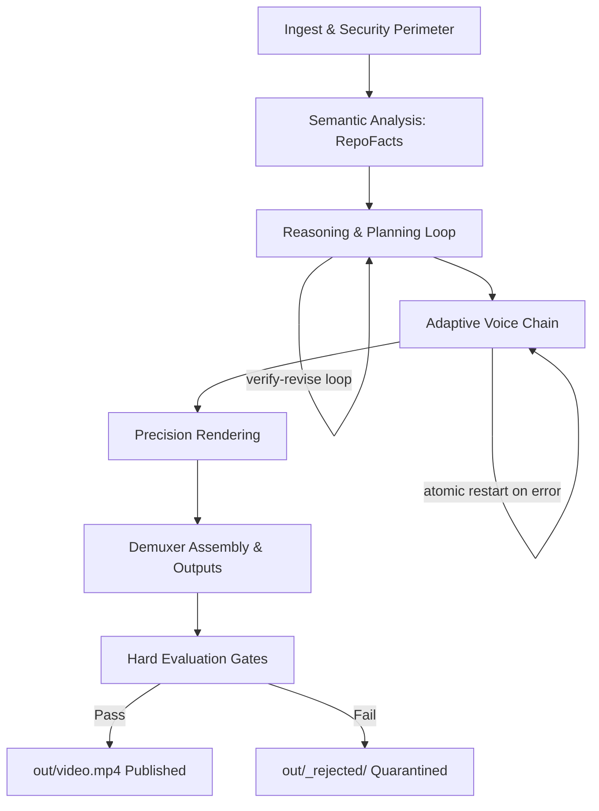

# DevVideo v2 Architecture

## Overview
DevVideo is an autonomous developer explainer generator built specifically to transform software repositories into structured, verifiable, and search-indexed explainer videos for AI video understanding and retrieval engines.

The architecture is composed of a strict linear 7-stage processing pipeline surrounded by multi-tier guardrails and bounded automated repair loops.

---

## 1. Security & Ingest Perimeter (`src/ingest.py`)
- **Strict URL Validation**: Validates `https://github.com/<owner>/<repo>[.git]` and rejects path traversal elements (`.` and `..`).
- **Clone Hardening**: Executes `git clone --depth 1 --single-branch --no-tags` with `-c core.symlinks=false -c protocol.file.allow=never -c core.hooksPath=<empty_temp_dir>`.
- **Resource Caps**: Strict bounds on checked-out repository size (<= 200 MB), scanned files (<= 50 files), file size (<= 100 KB/file), and total scanned text (<= 500 KB).
- **Multi-Class Secret Redaction**: Eliminates API keys, PEM blocks, JWT tokens, Slack/Google/GitHub secrets, and high-entropy strings, while protecting legitimate shell commands and file paths. Recorded secret hashes are passed to Gate 7 for independent verification.

---

## 2. Semantic Analysis (`src/analyze.py`)
- **Python AST Extraction**: Extracts internal module dependency graphs, top symbol definitions with verbatim line slices, docstrings, and CLI arguments (`argparse`, `click`, `typer`).
- **JS/TS Regex Extraction**: Traces relative `import` and `require()` calls across ECMAScript modules.
- **Sanitized README Parsing**: Removes raw HTML markup, badges, and markdown image syntax, preserving verbatim code fences and section text.
- **Strict Domain Relevance**: Computes domain relevance using word-boundary regular expressions (`\bkeyword\b`) against AI video processing concepts (frame, clip, index, embedding, retrieval, whisper, faiss, etc.).

---

## 3. Planners & Reasoning Loop (`src/plan.py`, `src/reason.py`)
- **Dual Planner Strategy**:
  - `OfflinePlanner`: Deterministic, fact-grounded generator producing a 7-scene blueprint directly from `RepoFacts`.
  - `ClaudePlanner`: LLM reasoning via standard input within a nonce-delimited untrusted data block, with tolerant JSON extraction.
- **Pre-TTS Reasoning & Verification**: Validates quote existence (>= 20 chars or full line), lexical overlap (>= 2 shared content tokens), verbatim code matches, command validity, and duration budget before speech synthesis begins.
- **Bounded Revise Loop**: Executes up to 2 revision iterations before falling back (`claude` -> `offline` -> minimal 3-scene degraded plan).

---

## 4. Voice Chain & Synchronization (`src/tts.py`)
- **Runtime Probing Chain**: Validates backends via real synthesis probes (`edge` -> `espeak-ng` -> `pyttsx3` -> `silent`).
- **Zero Mixed Voice Guarantee**: Any mid-scene failure triggers an atomic restart from scene 1 using the subsequent backend.
- **Audio Padding**: Applies 0.25s leading and 0.35s trailing acoustic padding to ensure words are not clipped during video muxing.

---

## 5. Precision Rendering (`src/render.py`)
- **Persistent Headless Browser**: A single Playwright Chromium instance (JavaScript disabled) renders DOM frames.
- **Visual Asset Construction**:
  - SVG internal module import graph with active beat highlighting.
  - Verbatim code excerpts highlighted line-by-line via Pygments, preserving exact indentation.
  - Interactive terminal typing animation.
  - Persistent chapter ribbon, glassmorphic caption card, and progress rail.
- **Pillow Fallback Engine**: Measures precise font metrics and flags overflow whenever text exceeds visible canvas areas.

---

## 6. Demuxer Assembly & Outputs (`src/assemble.py`)
- **Concat-Demuxer**: Assembles frame sequences with repeated final entries into H.264/AAC MP4 streams, guaranteeing zero stream drift.
- **Multimodal Companion Deliverables**:
  - `transcript.vtt` & `transcript.srt`: Subtitles synchronized to speech beats.
  - `chapters.json`: Chapter markers for media players.
  - `index.jsonl`: Timestamped retrieval records for vector search and indexing.
  - `thumbnail.png`: High-contrast preview card.
  - `manifest.json`: Execution metadata with relative paths, git SHAs, and SHA-256 media hash.

---

## 7. Runnable Hard Evaluation Gates (`src/evals/`)
Nine automated hard gates enforce production quality:
1. `duration`: Final MP4 <= 60.0s.
2. `av_sync`: Scene drift <= 0.15s, container stream drift <= 0.30s.
3. `audio_audible`: Mean volume > -50 dB (proves voice is present).
4. `groundedness`: 100% of scenes cite files with quote >= 20 chars and share >= 2 content tokens.
5. `code_verbatim`: On-screen code is an exact verbatim line range.
6. `command_validity`: All shell commands exist in repository fences (N/A if 0 commands).
7. `secret_leaks`: 0 secrets detected via independent regex scanning.
8. `no_overflow`: 0 dropped or overflowing lines across all rendered frames.
9. `frames_valid`: 100% of sampled frames are non-flat.
